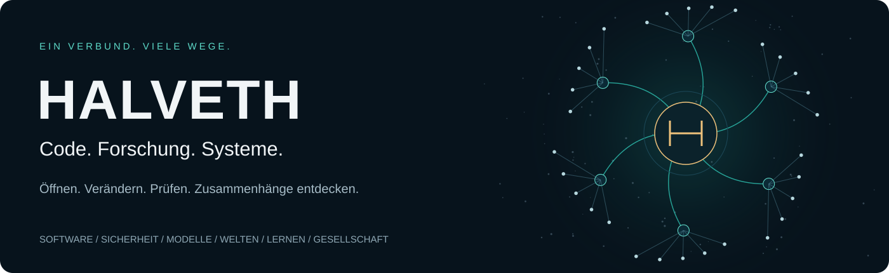

# Juri · Software and verifiable projects

[Deutsch](README.md) · [English](README.en.md) · [Русский](README.ru.md)

I build local tools, web applications and interactive models.

**Start here:** [Home](https://juri-halveth.github.io/en/) ·
[Project universe / Starship Lab](https://juri-halveth.github.io/universum/) ·
[KORRIDOT · Timeline](https://juri-halveth.github.io/console-only/) ·
[Search the public collection](https://juri-halveth.github.io/en/suche/) ·
[Profile and collaboration](https://juri-halveth.github.io/en/profil/).

The project universe opens the selected spaces. KORRIDOT presents events
and provenance as a timeline; network search leads to public repositories
and additional sources. The [project directory](https://juri-halveth.github.io/en/arbeiten/)
opens each application or guide with its source code. Detailed
[work samples](https://juri-halveth.github.io/en/belege/) remain available alongside them.

Person: **Juri**. Project: **HALVETH**. [Identity](IDENTITY.md).

## Public collection and curated selection

The collection count and observation time are recorded in
[`data/network-inventory.json`](data/network-inventory.json). The review snapshot
from **27 November 2026, 15:30 UTC** contains **23 public repositories**, including
two forks; twelve repositories are configured for Pages. Network search presents
the latest observed snapshot. The Pages workflow refreshes the public inventory
at build time and publishes the generated, checked views while retaining the
individual source timestamps.

The curated catalog dated **2 November 2026** contains **18 repository entries**:
16 project repositories, this website and the GitHub profile. The directory
presents **13 selected project cards** from that selection. Three withdrawn
game presentations remain in the source catalog and optional Lab; they are
excluded from the current portfolio.

[Scenes and models](https://juri-halveth.github.io/en/modelle/) retain the
interactive comparison of two views of the same four points, alongside scene
captures and explicit model rules. The
[technical map](https://juri-halveth.github.io/en/koennen/) links to functions,
tests and build definitions.

Project lead and curation: Juri / HALVETH. AI-assisted development. The portfolio
has German, English and Russian interfaces; Starship Lab currently uses German.

## Project universe · Starship Lab

[](https://juri-halveth.github.io/universum/)

**[Open Starship Lab →](https://juri-halveth.github.io/universum/)** · Software · Security · Models and visualization · Worlds · Learning · Public research

This separate browser space is linked directly from the homepage, directory
and footer. It covers the 18 curated repository entries; its local models and source links have
their own stated scope. [Sources and licences](universum/CREDITS.md).

## Build locally

Requires Node.js 24.

```sh
npm ci --ignore-scripts
npm run build
npm test
npm run preview
```

Install Chromium once with
`npx playwright install --with-deps --only-shell chromium`. Then
`npm run test:browser` starts its own local preview and checks two visitor
flows in all three languages: search and category → results or empty state →
reset, and missing page → projects or work samples → back. The actual browser
module is loaded. CI runs the same check before publication; linked project
applications are outside its scope.

Preview binds only to `127.0.0.1:4187`; `SPACE_PORT` selects another local port.
Keep confidential files outside this public working directory.

## Sources and verification

`data/scene-stage.json` binds capture provenance, processing, image hashes and
the byte-preserved MIT model. Static SVG remains readable without JavaScript;
interactive controls require it. Playback is explicit, finite and pauses when
hidden. `showcase.css` provides responsive layouts.

`data/site-catalog.json` is the shared navigation source for the website and
Starship Lab. Its dated snapshot and editorial selection are distinct from the
older source sets below.

`data/projects.json` describes 11 selected entries with source revisions and
limited review states. Local model checks bind to that exact source revision.
`data/public-repositories.json` lists 14 selected public repositories from its dated
snapshot; licence-review revisions remain separate. Inventory is not a full
security audit of those projects. Download releases retain their own versions.

`npm run refresh` updates those two older source sets from public default-branch
HEADs; it does not update the website catalog automatically. After a refresh,
run the build and tests and review the source diff. A newer source revision does
not inherit a test result from an older one.

The deterministic builder produces 43 HTML pages. The technical map links 12 work
samples across six areas to pinned functions, tests and build definitions.
Its profile-source byte binding remains explicit. `/forschung/` is a static
source/relationship index, not a running cross-project backend. The build does
execute the retained local geometric model to produce SVG.

Historical `/belege/` results retain their original dates and revisions.
The [24 October change record](docs/SCENE-FIRST-2026-10-24.md) and
[2 November navigation inventory](docs/review/2026-11-02/INVENTORY.md) document
their respective change and verification scopes.

## Collaboration and rights

Interactive prototypes, technical explanations and local tools can be scoped
as a concrete engagement with goals and acceptance criteria. The website is
source-available under its [path/version licence map](LICENSES.md), preserving
MIT exceptions and earlier grants. Linked projects retain their own terms.

Collaboration: **juri@halveth.de** · [Security](SECURITY.md): **security@halveth.de**
