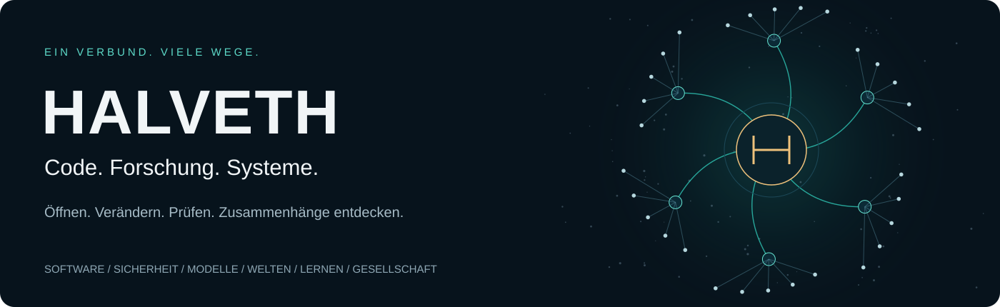

# Juri · Программы и проверяемые проекты

[Deutsch](README.md) · [English](README.en.md) · [Русский](README.ru.md)

Я создаю локальные инструменты, веб-приложения и интерактивные модели.

**Начать здесь:** [Главная](https://juri-halveth.github.io/ru/) ·
[Вселенная проектов / Starship Lab](https://juri-halveth.github.io/universum/) ·
[KORRIDOT · Временная шкала](https://juri-halveth.github.io/console-only/) ·
[Поиск по открытой коллекции](https://juri-halveth.github.io/ru/suche/) ·
[Профиль и сотрудничество](https://juri-halveth.github.io/ru/profil/).

Вселенная проектов открывает выбранные пространства. KORRIDOT показывает
события и их происхождение на временной шкале; сетевой поиск ведёт к открытым
репозиториям и дополнительным источникам. [Каталог проектов](https://juri-halveth.github.io/ru/arbeiten/)
открывает приложение или руководство вместе с исходным кодом. Подробные
[примеры работы](https://juri-halveth.github.io/ru/belege/) остаются доступны рядом.

Человек: **Juri**. Проект: **HALVETH**. [Соответствие имён](IDENTITY.md).

## Открытая коллекция и редакционная подборка

Количество репозиториев и время наблюдения указаны в
[`data/network-inventory.json`](data/network-inventory.json). Снимок проверки
от **27 ноября 2026 года, 15:30 UTC** содержит **23 открытых репозитория**,
включая два форка; для двенадцати репозиториев настроен Pages. Сетевой поиск
показывает последний наблюдённый снимок. Процесс Pages обновляет открытый
инвентарь при сборке и публикует сформированные, проверенные страницы,
сохраняя отдельные временные отметки источников.

Редакционный каталог от **2 ноября 2026 года** содержит **18 записей**:
16 проектных репозиториев, этот сайт и профиль GitHub. В каталоге проектов
показаны **13 выбранных карточек** из этой подборки. Три снятые с показа
игровые презентации остаются в каталоге источников и дополнительной
лаборатории; в актуальном портфолио они не представлены.

В разделе [сцен и моделей](https://juri-halveth.github.io/ru/modelle/)
сохранено интерактивное сравнение двух видов тех же четырёх точек, снимки
сцен и описание правил модели.
[Техническая карта](https://juri-halveth.github.io/ru/koennen/) ведёт к
функциям, тестам и определениям сборки.

Руководство и отбор: Juri / HALVETH. Разработка с помощью ИИ. Портфолио доступно
на немецком, английском и русском языках; интерфейс Starship Lab пока на немецком.

## Вселенная проектов · Starship Lab

[](https://juri-halveth.github.io/universum/)

**[Открыть Starship Lab →](https://juri-halveth.github.io/universum/)** · Программы · Безопасность · Модели и визуализация · Миры · Обучение · Открытые исследования

Это отдельное пространство в браузере, доступное прямо с главной страницы,
из каталога и нижней части сайта. Оно охватывает 18 выбранных записей; назначение локальных
моделей и ссылок на источники указано отдельно.
[Источники и лицензии](universum/CREDITS.md).

## Локальная сборка

Требуется Node.js 24.

```sh
npm ci --ignore-scripts
npm run build
npm test
npm run preview
```

Один раз установите Chromium командой
`npx playwright install --with-deps --only-shell chromium`. Затем
`npm run test:browser` сам запускает локальный предпросмотр и проверяет два
пути посетителя на трёх языках: поиск и категория → результаты или пустой
список → сброс; отсутствующая страница → проекты или примеры работы → назад.
Загружается настоящий браузерный модуль. Та же проверка выполняется в CI
перед публикацией; приложения по внешним ссылкам в неё не входят.

Предпросмотр доступен только на `127.0.0.1:4187`; `SPACE_PORT` задаёт другой
локальный порт. Конфиденциальные файлы хранятся отдельно от публичного дерева.

## Источники и проверки

`data/scene-stage.json` связывает происхождение, обработку и хеши снимков
с точной копией MIT-модели. Статический SVG читается без JavaScript;
интерактивным элементам нужен JavaScript. Воспроизведение запускается явно,
имеет конец и приостанавливается при скрытии. Макет адаптируется к экрану.

`data/site-catalog.json` — общий источник навигации сайта и Starship Lab.
Его датированный снимок и редакционный отбор отличаются от более ранних
наборов источников ниже.

`data/projects.json` описывает 11 избранных входов с версиями исходников и
ограниченными статусами проверки. Локальные тесты связаны с той же ревизией.
`data/public-repositories.json` перечисляет 14 выбранных публичных репозиториев из датированного
наблюдения. Версии лицензионной проверки указаны отдельно. Это перечень,
а не полный аудит безопасности всех продуктов. Пакеты загрузки имеют свои версии.

`npm run refresh` обновляет эти два ранних набора по HEAD стандартных веток
публичных репозиториев; каталог сайта автоматически не меняется. После
обновления выполните сборку и тесты и проверьте изменения исходников.
Новая ревизия не наследует результат проверки прежней версии.

Детерминированная сборка создаёт 43 HTML-страницы. Карта интерфейсов ведёт
от 12 примеров в шести областях к функциям, тестам и определениям сборки.
`/forschung/` показывает статический индекс источников и связей; он не
запускает связанные продукты. Сборка отдельно исполняет локальную модель
геометрии для создания SVG. Исторические результаты `/belege/` сохраняют
свои даты и ревизии. [Журнал от 24 октября](docs/SCENE-FIRST-2026-10-24.md) и
[описание навигации от 2 ноября](docs/review/2026-11-02/INVENTORY.md)
фиксируют изменения и границы проверок на соответствующие даты.

## Сотрудничество и права

Интерактивный прототип, техническое объяснение или локальный инструмент можно
согласовать как конкретную задачу с целью, объёмом и критериями приёмки.
Применяется [карта лицензий по путям и версиям](LICENSES.md); исключения MIT,
ранее выданные разрешения и условия исходных проектов сохраняются.

Сотрудничество: **juri@halveth.de** · [Безопасность](SECURITY.md): **security@halveth.de**
