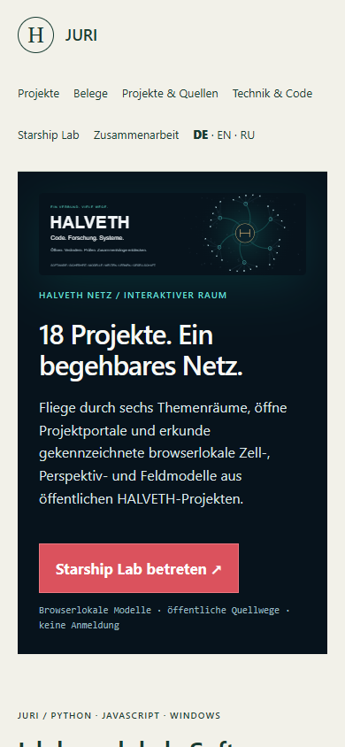
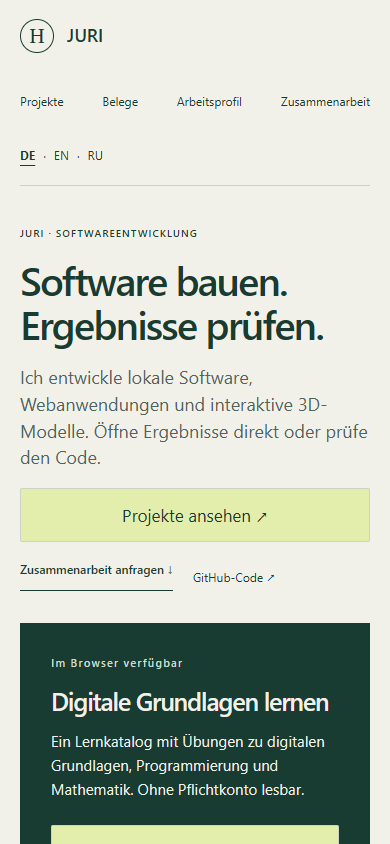

# Website before / after · review packet

Compared against Website `origin/main` `3bdf0b3851ee592860c9518dbd7e66e8630db39c`. This is the local generated candidate for PR review; it is not evidence of a deployed public change.

## Visitor path

| Measure | Before | Candidate after |
| --- | --- | --- |
| First statement | “18 Projekte. Ein begehbares Netz.” as a Starship gateway | “Software bauen. Ergebnisse prüfen.” with the developer role above it |
| Main homepage sections | 6 direct `main > section` elements | 4: one hero with first direct card, three more cards, method, contact |
| Hero/gateway blocks | 2 (`.universe-gateway`, `.scene-hero`) | 1 (`.service-hero`) |
| Header navigation | 6 destination links plus 3 language links in the nav (9 anchors) | 4 destination links; 3 language links remain visible alongside the nav |
| First primary CTA | Enter Starship Lab, then select a project there | View projects; the first featured project has its own direct action on the same screen |
| Clicks from first CTA to a project | At least 2 via Lab selection | 2 via directory selection; 1 via the first direct project card |
| Homepage scene/model presentation | Scene wall, scene demo, purpose band, map teaser all in the primary flow | Those homepage blocks absent; scene demo and map teaser live at `/modelle/` |
| Project count in visitor copy | 18 and 4 used without a clear subset relationship | 18 public repository entries = 16 project repos + Website + profile. 13 currently presented cards; 3 withdrawn presentations remain source-only. No 18-product claim in the hero. |

## Section movement

| Before on `/` | After | Action |
| --- | --- | --- |
| Starship gateway with banner | `/universum/` via directory and footer | Removed from homepage DOM; optional path retained. |
| Scenic hero with second headline and four flagships | One service hero and four direct cards | Old scenic hero no longer rendered on homepage. |
| Scene demo and purpose band | `/modelle/` | Kept as a specialist experience, linked from the directory. |
| Technical map teaser | `/modelle/`, then `/koennen/` | Removed from homepage DOM; existing map URL retained. |
| Eleven detailed cards and separate 14-repository list on `/arbeiten/` | Thirteen unique active project cards from the 18-entry canonical source | Replaced as the active directory. The older dated datasets and evidence remain in the repository and specialist routes. |
| Lab link injected into primary nav | Lab link in directory and footer | Four primary nav targets now mean projects, work samples, profile and contact. |
| Five generic subpages with the same research-lab introduction | Short, distinct destinations at `/audits/`, `/handbuch/`, `/pulsar/`, `/zertifikate/`, `/werkzertifikate/` | Existing URLs retained; only `/handbuch/` keeps the pinned local launch command. |
| Two learning cards sourced from the older selected-project file | Two learning cards sourced from the canonical Website catalog | `/lernen/` stays directly usable and links onward to all current projects. |

## Mobile observation

The images below were rendered locally with Chrome at **390 × 844 CSS px**. The before file is `origin/main:index.html` plus `origin/main:portfolio.css`; other unchanged shared assets came from this checkout. The after image is the generated candidate. This compares the first viewport rather than an entire page or a real iPhone session.

At 390 px, the before gateway began at y=194 and showed no project card in the first viewport. The candidate hero begins at y=186; the first project card begins at y=623 and its action appears at the bottom edge. At 320 px, the candidate primary CTA ends at y=586 and the first card begins at y=666. At 375 px, the first card begins at y=623. Home and directory had no horizontal document overflow at 320, 375, 390, 768 or 1440 px in the local Chrome run. Header visual order matches keyboard focus order on narrow screens.

The compact directory keeps project search visible. Category buttons sit inside a native disclosure, so the first software card enters the 390 px first viewport. See [directory screenshot](after-directory-390.png). The 13 cards remain in the HTML when JavaScript is unavailable; the finder only narrows what is shown.

## Review and publication boundary

The full local test suite passed 94/94. A 30-target HEAD probe returned HTTP 200 for current cards and meta links on 2026-11-02. These checks establish generated structure and observed reachability. They do not establish application behavior, content quality, broad security coverage, or a successful Pages deployment. The PR remains open for visual and link review; after merge, the published URL and deployed bytes still need a separate check.
